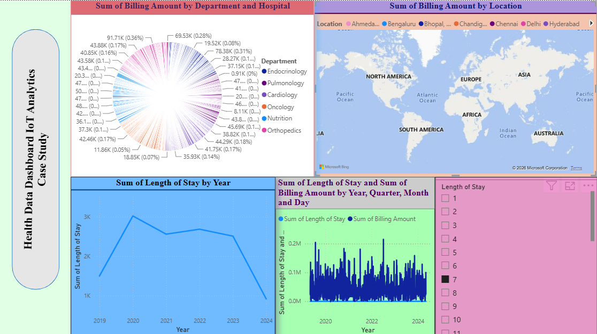

# Healthcare Data Analytics Dashboard

## Project Overview

This project is an interactive Healthcare Data Analytics Dashboard developed using Microsoft Power BI to analyze healthcare and patient-related data.

## Objectives

* Analyze healthcare billing amounts.
* Explore hospital-related data.
* Visualize patient length of stay.
* Present key insights through interactive visualizations.

## Tools & Technologies

* Microsoft Power BI
* Data Visualization
* Data Analytics

## Dashboard Features

* Interactive charts and visualizations
* Healthcare billing analysis
* Hospital data analysis
* Patient length-of-stay analysis

## Project File

The Power BI dashboard file is available in this repository:
## Dashboard Preview

## Dashboard Preview

`Healthcare_Dashboard.pbix`

## Author

Tushar Pancheshwar
